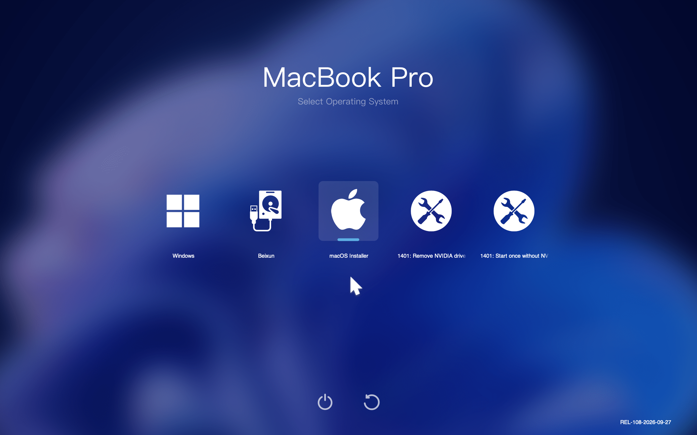
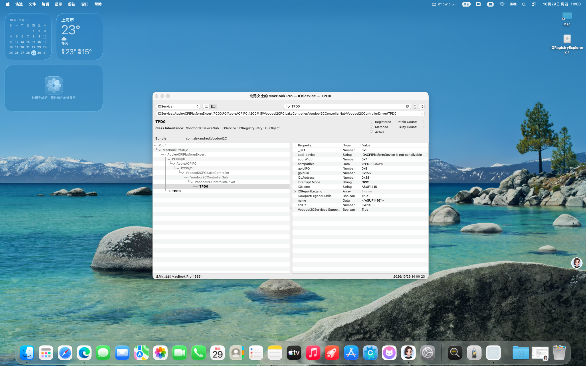
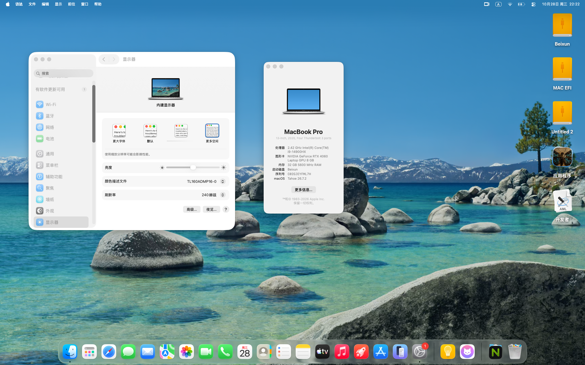
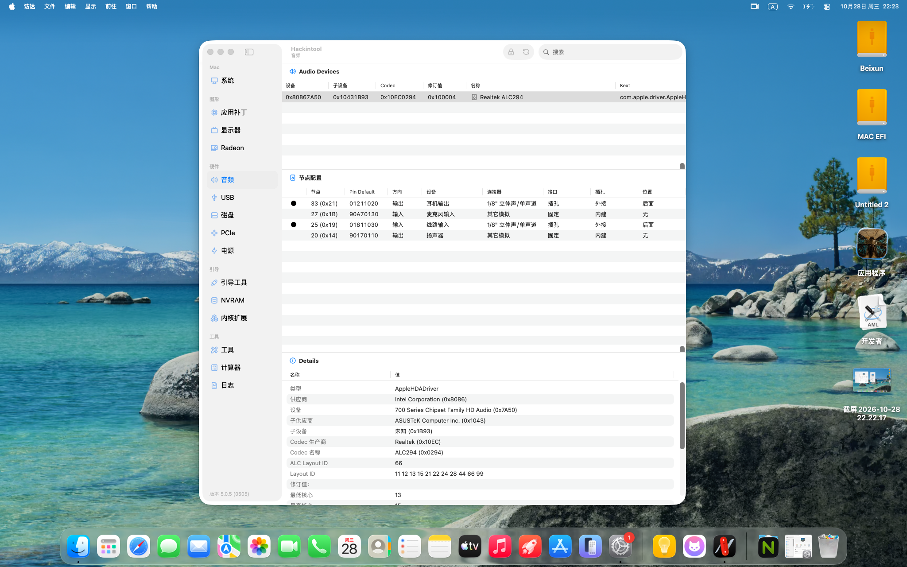
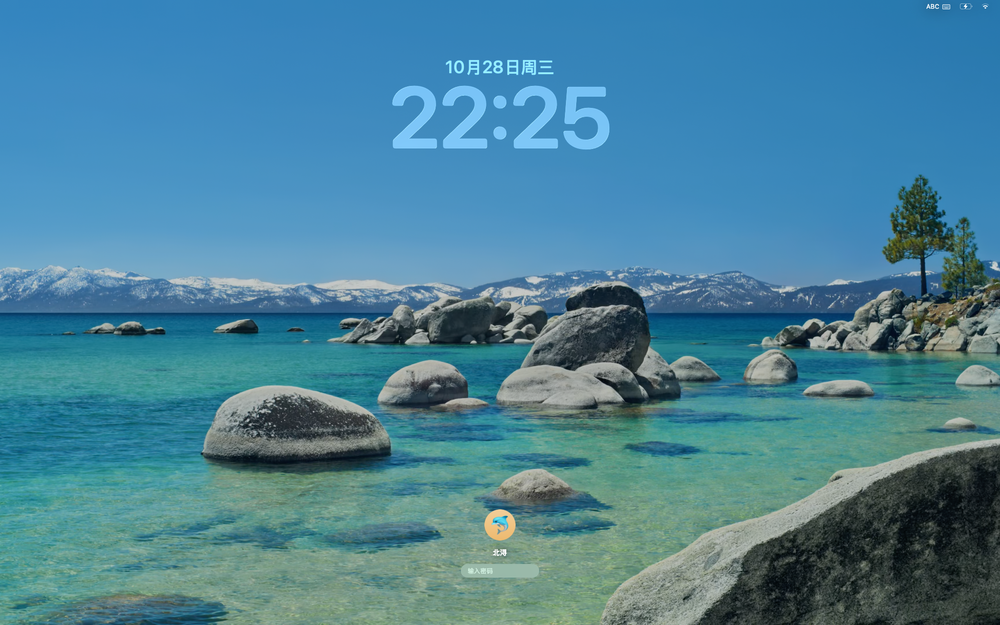
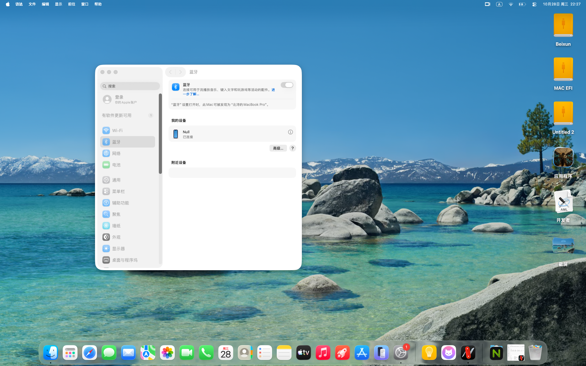
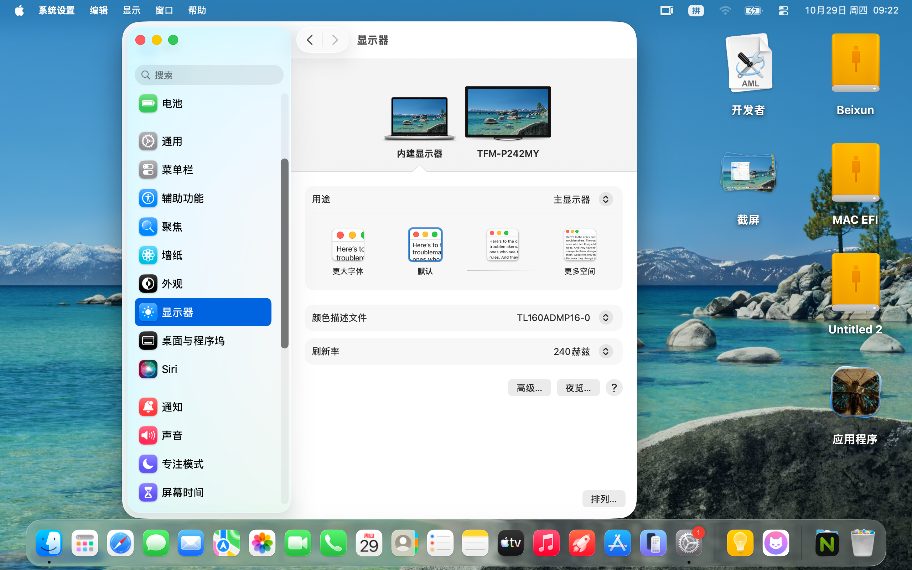

# ROG Strix G16 G614JVR (枪神8) · Hackintosh EFI
**Platform: Raptor Lake-HX | CPU: Intel Core i9-14900HX**

> 🔖 Repository: `G614JVR_G614JVR`
> Target Device: ASUS ROG STRIX G16 G614JVR
> Bootloader: OpenCore (Pure UEFI)
> Host OS Range: macOS Sequoia 15.8 ~ Tahoe 26.7.3

---

## Overview
This EFI is dedicatedly engineered for the ASUS ROG Strix G16 (G614JVR, Gunslinger 8) mobile workstation.
Built upon Raptor Lake-HX architecture, this port leverages community experimental frameworks to bring macOS support to this high-performance gaming laptop.

> 📌 Alternative Exploration:
> Thunderbolt 4 eGPU (AMD) is a theoretically viable route for native Metal acceleration.
> TB4 protocol enjoys relatively mature compatibility under macOS.
> *Note: This workflow remains unvalidated due to lack of physical peripherals, for reference only.*

> ⚠️ NVIDIA Metal Driver Notice (Repeat):
> The bundled NVIDIA Metal stack is experimental, community-maintained, **NOT officially endorsed by Apple**.
> Stability is not guaranteed. Proceed with caution for all test scenarios.

---

## Showcase

  
  
  
  
  
  
  
  

---

## ⚖️ Legal & Compatibility Disclaimer
1. This configuration is **laptop-specific**, not suitable for desktop builds.
2. Initial skeleton generated via NullMoth `1401` Windows utility, iteratively refined & stabilized with collaboration from [极光呆呆脑 (bilijp153)](https://github.com/bilijp153).
3. macOS installation will overwrite target storage partitions. **Full data backup is mandatory before any operation.**
4. On 11th+ Gen Intel ROG notebooks, Resizable BAR / CSM are firmware-hardcoded with no exposed BIOS toggle. Manual intervention is neither required nor available.
5. DGPU backlight control: Append boot arg `nvrmacpibl=1` to activate backlight regulator for discrete GPU; omit otherwise.
6. Trackpad instability mitigation: Native perfect interrupt mode is implemented by default.
Add boot arg ` -vi2c-force-polling` to fall back to forced polling mode on demand.

---

## Hardware Compatibility Matrix
| Component | Specification | Status | Remarks |
| ---- | ---- | ---- | ---- |
| Mainboard | ASUS ROG STRIX G16 G614JVR (HM770 PCH) | ✅ Working | Raptor Lake-HX SoC |
| CPU | Intel Core i9-14900HX (8P+16E, 24C/32T) | ✅ Working | Requires heterogeneous core patch |
| DRAM | Onboard + SODIMM DDR5 | ✅ Working | Depends on SKU |
| iGPU | Intel UHD Graphics (Raptor Lake) | ✅ Working | Powered by WhateverXe / WhateverXe-Graphics |
| dGPU | NVIDIA RTX 4060 Laptop | ⚠️ Experimental | NullMoth Metal Driver v3.1, community-only |
| Audio | Realtek HDA | ✅ Working | Speaker + Headphone output supported, layout-id: 21,22,28,66,99 |
| Ethernet | Realtek RTL8111 | ✅ Working | RealtekRTL8111.kext |
| WLAN | Intel Wi-Fi 6E AX211 | ✅ Working | OpenIntelWireless / itlwm |
| Bluetooth | Intel AX211 Integrated BT | ✅ Working | OpenIntelWireless |
| NVMe Storage | PCIe4.0 NVMe SSD | ✅ Working | Dual-boot Windows + macOS |
| Keyboard / Trackpad | ASUF1416 / N-Key | ✅ Working | NKeyBlocker.kext resolves infinite enumeration glitch |
| Touch NumberPad G533 | Embedded touch numpad | ✅ Working | AuraPilot daemon / lightweight driver available |
| Battery | Internal Smart Battery | ✅ Working | EC battery readout |
| DP (Thunderbolt 4) | Thunderbolt 4 Type-C | ⚠️ Pending | Await Xe driver maturation or alternative solution |
| HDMI | HDMI Video Output | ✅ Working | Routed through RTX4060, governed by NullMoth driver |
| DP (100W PD) | Type-C DP + PD Power Delivery | ✅ Working | Routed through RTX4060, governed by NullMoth driver |

---

## Stack Versioning
| Module | Version & Notes |
| ---- | ---- |
| macOS | Tahoe 26.7.3 |
| Bootloader | OpenCore 0.9.x / 1.0.x (check repo EFI folder) |
| SMBIOS | MacBookPro16,2 |
| Boot Mode | Pure UEFI |

> 🚨 Critical: Regenerate your own Serial, MLB & ROM values for SMBIOS.
> Reusing leaked identifiers will break iMessage, FaceTime & Apple ecosystem services.

---

## BIOS Preconfiguration (Prerequisite)
> BIOS Entry: `F2` on power-on | Boot Menu: `Esc`
> Best Practice: After BIOS modification, boot into Windows once to verify boot chain integrity prior to macOS deployment.

### Mandatory Settings
| Option | Target State | Description |
| ---- | ---- | ---- |
| **VMD (Volume Management Device)** | Disabled | Highest priority. VMD blocks raw NVMe enumeration under macOS; AHCI mode is required. |
| **Secure Boot** | Disabled | Set `Other OS` in Secure Boot OS Type field. Unsigned OpenCore payload will be rejected otherwise. |
| **Above 4G Decoding** | Enabled | Hard requirement of NullMoth NVIDIA Metal driver for complete BAR mapping. |

### Windows BitLocker Warning
If BitLocker encryption is active on your Windows volume, suspend BitLocker or securely store recovery keys **before altering Secure Boot configuration**.
A BIOS configuration change will trigger BitLocker recovery lockout.

---

## Credits & Acknowledgements
- [OpenCorePkg](https://github.com/acidanthera/OpenCorePkg) — The foundation of this bootloader
- [OpenIntelWireless](https://github.com/OpenIntelWireless) — Intel Wi-Fi & Bluetooth stack
- [NullMoth nvidia-macos-driver](https://github.com/nullmoth/nvidia-macos-driver) — Experimental NVIDIA Metal runtime
- [NullMoth 1401 Toolchain](https://github.com/nullmoth/1401) — Initial EFI generation utility
- [itlwm](https://github.com/laobamac/itlwm/releases) — Intel Wi-Fi kernel extension
- [b00t0x · WhateverXe Series](https://github.com/b00t0x) — iGPU acceleration framework
- [Mochen-wu · WhateverXe-G614JVR](https://github.com/Mochen-wu/WhateverXe-G614JVR) — Device-specific WhateverXe fork
- [Mochen-wu · N-key Reset Driver](https://github.com/Mochen-wu/N-key-infinite-enumeration-reset-malfunction) — N-Key enumeration bug fix
- [AuraPilot / Mac-asus-numberpad-driver](https://github.com/Mochen-wu/AuraPilot-macOS) — ASUS AuraPilot daemon / lightweight driver
- [asus-linux-drivers asus-numberpad-driver](https://github.com/asus-linux-drivers/asus-numberpad-driver) — Original numpad research
- [Dortania OpenCore Guide](https://dortania.github.io/) — Industry-standard Hackintosh documentation
- [极光呆呆脑 (bilijp153)](https://github.com/bilijp153) — Testing, tuning & co-development

---

## License & Scope
This repository is built for **technical research and educational purposes only**.
Please comply with local laws and end-user agreements of relevant vendors.
No commercial use, no warranty of any kind.
